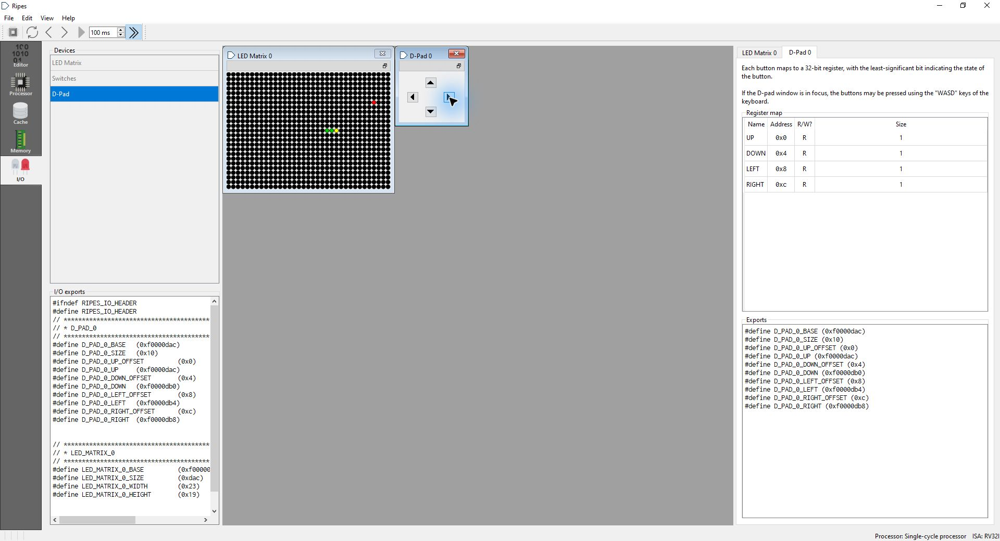

# Snake em assembly RISC-V

**Aluno:** Vinicius Medeiros Peres

**Disciplina:** Arquitetura de Computadores — Universidade Católica de Santos

**Professor:** Walter S. Oliveira

Jogo da cobrinha para o Ripes, usando RV32I. A matriz de LEDs mostra o tabuleiro e o D-Pad controla a direção. Comer aumenta o corpo e soma um ponto; bater na borda ou no corpo termina a partida.

## Como executar

1. Selecione **Single-cycle processor**, com M e C desmarcadas. Mantenha `sp = 0x7ffffff0`.
2. Na aba **I/O**, adicione primeiro **LED Matrix**, com 35 colunas e 25 linhas, e depois **D-Pad**. Confira os endereços: matriz `0xF0000000` e D-Pad `0xF0000DAC`. Se forem diferentes, recrie os dispositivos nessa ordem ou ajuste as constantes no código.
3. Em **File → Load program**, marque **Source file** e abra [src/snake.s](src/snake.s). O arquivo `.s` não é um executável ELF.
4. Use **Run (F8)**, volte à aba **I/O** e clique numa seta para começar. A cobra começa indo para a direita; uma direção oposta à atual é ignorada.
5. Após game over, solte os controles e pressione uma seta para reiniciar. O console fica na parte inferior da aba **Processor**.

As cores são: cabeça amarela, corpo verde, comida vermelha e colisão magenta. Na borda, o magenta marca a última posição válida e permanece até a nova partida.

`DELAY = 1000` controla a espera entre passos. Aumente para diminuir a velocidade; use sempre um inteiro positivo.

## Exemplo de entrada e saída

Na execução registrada, foi pressionada a seta direita para começar. Sem outras entradas e sem comida no caminho, a cobra alcançou a borda. O console mostrou:

```text
SNAKE RV32I - aperte uma direcao no D-Pad para comecar
GAME OVER! Pontos: 0
Aperte uma direcao para jogar de novo.
```



## Testes e resultados

As capturas registram [game over](docs/testes/game-over-magenta.jpg), [console](docs/testes/console-game-over.jpg) e [reinício](docs/testes/reinicio-apos-game-over.jpg). O [relatório](RELATORIO.md) explica os testes e inclui o vídeo.

Medições no Ripes v2.2.6-75-g183291e, em RV32I, incluindo preparação, chamada, retorno e saída do programa de medição:

| Teste | Instruções | Ciclos Single-cycle | Ciclos 5-stage | CPI 5-stage |
|---|---:|---:|---:|---:|
| `xy_to_addr` | 16 | 16 | 26 | 1,625 |
| Espera, DELAY = 1000 | 11.012 | 11.012 | 25.020 | 2,272 |
| Espera, DELAY = 3000 | 33.013 | 33.013 | 75.021 | 2,272 |

O atraso cresce aproximadamente na proporção de `DELAY`. No pipeline, desvios e dependências entre leitura e teste aumentam os ciclos. CPI sozinho não compara a velocidade física dos processadores, pois o período de clock também importa.

Para repetir, abra um arquivo de [benchmarks/](benchmarks/) como **Source file**, execute até terminar e anote **Cycles**, **Instrs. retired** e **CPI** na aba Processor. Repita com **5-stage processor**, mantendo M e C desmarcadas. Não é necessário instalar Node.js nem gerar arquivos.

## Arquivos

| Caminho | Conteúdo |
|---|---|
| [src/snake.s](src/snake.s) | Jogo completo |
| [RELATORIO.md](RELATORIO.md) | Funcionamento, chamadas, testes e análise |
| [docs/PROPOSTA.md](docs/PROPOSTA.md) | Descrição do escopo |
| [benchmarks/](benchmarks/) | Quatro exemplos curtos de medição |
| [docs/testes/](docs/testes/) | Capturas e registros de execução |
| [docs/desempenho/](docs/desempenho/) | Contadores e dados da compilação C |
| [c-reference/snake.c](c-reference/snake.c) | Referência parcial em C |
| [docs/snake_compilado.s](docs/snake_compilado.s) | Saída do Clang 17.0.1 para RV32I |

A referência C usa o mesmo `DELAY = 1000`, mas não implementa todas as saídas e o reinício do assembly. A comparação está no relatório.
