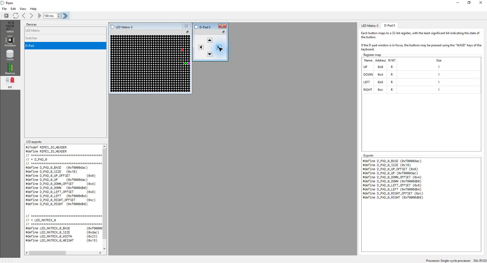
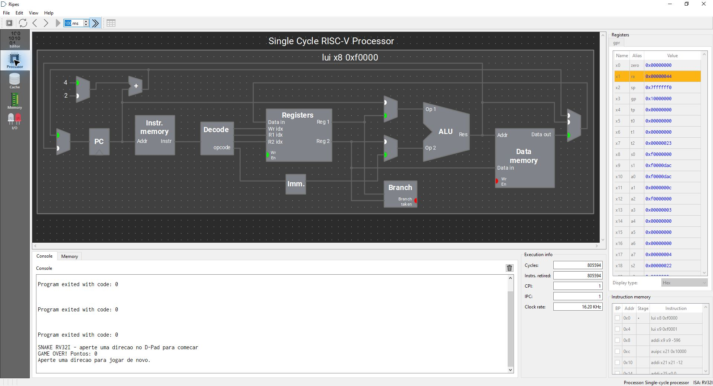
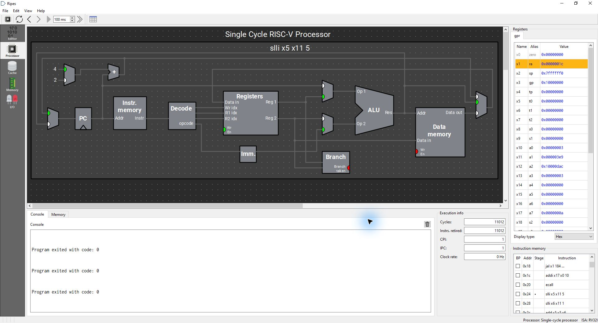
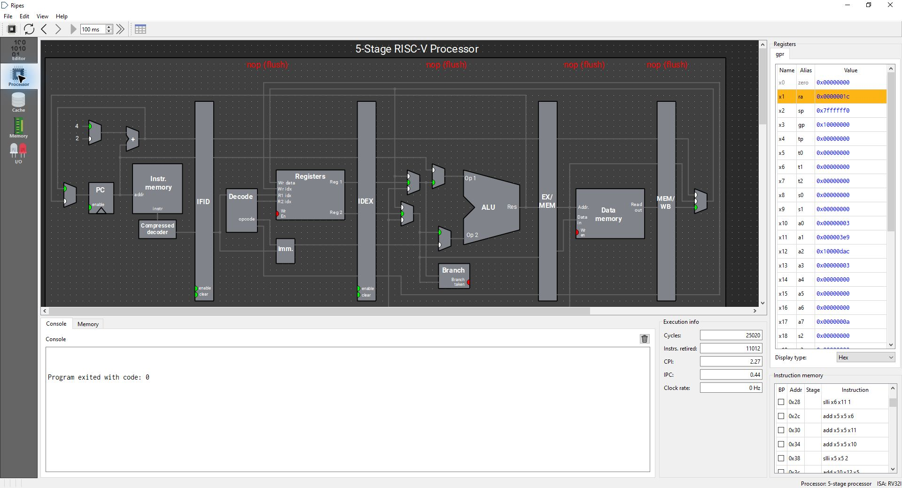

# Relatório: Snake em assembly RISC-V

Aluno: Vinicius Medeiros Peres

Disciplina: Arquitetura de Computadores — Universidade Católica de Santos

Professor: Walter S. Oliveira

Simulador: Ripes v2.2.6-75-g183291e, Windows x86_64, RV32I

## 1. Objetivo e funcionamento

O projeto implementa Snake usando instruções RV32I, memória, sub-rotinas e periféricos do Ripes. A cobra se movimenta pela matriz de LEDs, cresce ao comer e termina a partida ao colidir. O D-Pad fornece as entradas e o console mostra a pontuação.

`main` prepara os endereços, imprime a mensagem inicial e apaga a matriz. Em `new_game`, o programa espera os botões serem soltos e uma nova seta ser pressionada. Só então limpa o tabuleiro, zera a pontuação e desenha três gomos em (5,12), (6,12) e (7,12), indo para a direita. O tempo de espera contribui para a semente do sorteio.

Cada passagem por `game_loop` espera `DELAY` iterações, lê a direção e calcula a próxima posição. Se sair do tabuleiro, ocorre game over. Se houver comida, o corpo cresce e a pontuação aumenta. Caso contrário, a cauda avança antes do teste de colisão com o corpo. Isso permite ocupar a casa que a cauda acabou de liberar.

O vetor `body`, em `.data`, guarda os endereços dos LEDs do corpo. Tem 875 palavras, ou 3500 bytes, e funciona como fila circular. Os índices da cabeça e da cauda avançam quatro bytes e voltam a zero no fim do vetor. O próprio conteúdo dos LEDs indica quais casas estão ocupadas.

O endereço de uma casa é `base + (y*35 + x)*4`. Como RV32I não tem multiplicação, `xy_to_addr` calcula `y*35` por `y*32 + y*2 + y`, com deslocamentos e somas. São sete instruções de cálculo e uma de retorno.

O sorteio usa xorshift32: seis bits fornecem x e cinco fornecem y. Coordenadas fora de 35 × 25 ou em casas ocupadas são descartadas. Ao ocupar as 875 casas, o programa mostra a vitória sem tentar sortear outra comida.

## 2. Instruções e memória

| Grupo | Exemplos | Uso |
|---|---|---|
| Aritmética | `add`, `addi` | Posições, índices e contadores |
| Lógica | `andi`, `or`, `ori`, `xor` | Máscaras, controles e sorteio |
| Deslocamento | `slli`, `srli` | Cálculo do endereço e xorshift |
| Comparação | `sltu` | Indicar botão pressionado |
| Memória | `lw`, `sw` | LEDs, D-Pad, corpo e pilha |
| Desvios | `beq`, `bne`, `blt`, `bge`, `bgeu` | Colisões e laços |
| Chamadas | `jal`, `ret` | Entrada e retorno das rotinas |
| Sistema | `ecall` | Texto e pontuação no console |

`li`, `la`, `mv`, `j`, `beqz`, `bnez` e `ret` são pseudo-instruções. Por exemplo, `ret` corresponde a `jalr x0, 0(ra)` e `mv` usa `addi` com zero. `li` pode precisar de uma ou duas instruções, conforme o valor.

O registrador `x0` sempre vale zero. É usado para apagar LEDs, comparar com zero e descartar o endereço de retorno em saltos. Na colisão com a parede, `bgeu` compara sem sinal: tanto x = 35 quanto x = −1 ultrapassam o limite 35 nessa comparação.

| Região | Conteúdo |
|---|---|
| `body`, em `.data` | 3500 bytes para o corpo |
| Mensagens, em `.data` | Strings terminadas em zero |
| `0xF0000000` a `0xF0000DAB` | 875 LEDs, uma palavra `0x00RRGGBB` por casa |
| `0xF0000DAC` a `0xF0000DBB` | D-Pad: cima, baixo, esquerda e direita, offsets 0, 4, 8 e 12 |
| Pilha | Quadros de 16 bytes nas rotinas que fazem chamadas |

## 3. Convenção de chamada

As chamadas usam `jal ra, rotina` e retornam com `ret`. Argumentos passam nos registradores `a` e resultados voltam em `a0` ou `a0/a1`.

| Rotina | Entrada | Resultado |
|---|---|---|
| `xy_to_addr` | a0 = x, a1 = y, a2 = base dos LEDs | a0 = endereço |
| `rand` | a0 = semente | a0 = nova semente |
| `spawn_food` | a0 = semente, a1 = base dos LEDs | Pinta comida; a0 = nova semente |
| `delay_and_poll` | a0 = direção, a1 = semente, a2 = base do D-Pad | a0 = próxima direção, a1 = semente atualizada |
| `any_pressed` | a0 = base do D-Pad | a0 = 0 ou 1 |
| `wait_release` | a0 = base do D-Pad | Espera todos os botões serem soltos |
| `clear_screen` | a0 = base dos LEDs | Apaga as 875 casas |

`main` mantém o estado em `s0`–`s11` e não retorna. As sub-rotinas preservam esses registradores: recebem o estado pelos argumentos e devolvem as alterações pelos resultados. `delay_and_poll` não altera diretamente `s9` ou `s11`.

`spawn_food` e `wait_release` salvam `ra` na pilha porque chamam outras rotinas. Também guardam os argumentos necessários depois dessas chamadas. O quadro tem 16 bytes e `sp` é restaurado no retorno. Os registradores `a` e `t` são temporários; quem chama não deve esperar que sejam preservados.

## 4. Entrada e saída

As setas iniciam a partida e mudam a direção. A direção contrária à atual é ignorada. Durante a espera, os quatro botões são consultados a cada iteração.

Amarelo indica cabeça, verde indica corpo e vermelho indica comida. No game over, a casa da colisão fica magenta; na borda, fica magenta a última posição válida. A matriz só é limpa quando começa a próxima partida.

Exemplo observado após seguir reto sem comer:

```text
SNAKE RV32I - aperte uma direcao no D-Pad para comecar
GAME OVER! Pontos: 0
Aperte uma direcao para jogar de novo.
```

## 5. Testes e evidências

### Interface do Ripes

O programa completo foi carregado como **Source file**, com Single-cycle, RV32I e `DELAY = 1000`.

| Verificação | Resultado observado |
|---|---|
| Pressionar direita para começar | Cobra com três gomos se movimenta para a direita |
| Seguir sem novas entradas, sem comida no caminho | Game over com zero pontos |
| Esperar após a colisão | LED magenta permanece na última casa da linha |
| Soltar e pressionar direita novamente | Nova cobra e nova comida; partida reiniciada |







### Casos controlados

Foram executadas 40 verificações no Ripes CLI: 20 casos em Single-cycle e os mesmos 20 em 5-stage. Os [registros](docs/testes/resultados.json) guardam os valores esperados, registradores finais e resultados do simulador. As [saídas de console](docs/testes/console.txt) incluem colisão e vitória.

Esses casos usaram LEDs e D-Pad representados em RAM, com entradas fixas. Dez casos verificaram sub-rotinas, incluindo preservação de `s0`–`s11` e restauração de `sp`. Dez executaram um passo do laço original em estados preparados: movimento, crescimento, quatro bordas, corpo, casa liberada pela cauda, inversão e vitória. Os saltos para continuar ou reiniciar foram substituídos pela coleta do resultado.

A vitória foi testada partindo de um corpo com 874 casas e comida na última casa livre. O resultado foi tamanho 875 e `VOCE VENCEU! Pontos: 872`. Isso verifica o estado final, não uma partida interativa inteira até a vitória.

Para testar pela interface, inicie uma partida, conduza até uma comida, tente inverter a direção, provoque uma colisão e reinicie. Confira crescimento, pontuação e cores em cada etapa. As capturas comprovam os casos observados na interface, não todos os casos controlados.

### Vídeo

[Demonstração em MP4](https://github.com/viniciusmedeirosdev/snake-riscv/releases/download/demonstracao-2026-11-24/snake-riscv-demonstracao.mp4), gravada em 24/11/2026, com aproximadamente 1 minuto e 56 segundos. A gravação é anterior às correções de preservação de registradores e permanência do LED magenta. As capturas desta seção mostram a versão corrigida.

## 6. Análise arquitetural

### Procedimento

Os quatro arquivos de [benchmarks/](benchmarks/) podem ser abertos diretamente no Ripes. Cada programa prepara os argumentos, executa um trecho e termina com `ecall 10`. As medições usam RV32I, sem M/C, em **Single-cycle** e **5-stage com forwarding e detecção de hazards**.

Carregue um arquivo como Source file, execute até terminar e anote Cycles, Instrs. retired e CPI na aba Processor. Troque o processador e execute novamente desde o início. No teste de espera, os quatro valores do D-Pad estão zerados em RAM, representando botões soltos.

Os contadores incluem preparação, chamada, retorno e saída. Não são os ciclos de uma partida nem somente o corpo da rotina. Os valores brutos estão em [resultados.json](docs/desempenho/resultados.json).

| Programa | Instruções | Ciclos Single-cycle | CPI Single-cycle | Ciclos 5-stage | CPI 5-stage |
|---|---:|---:|---:|---:|---:|
| `xy_base.s`, sem chamada | 7 | 7 | 1 | 13 | 1,857 |
| `xy_to_addr.s` | 16 | 16 | 1 | 26 | 1,625 |
| `delay_1000.s` | 11.012 | 11.012 | 1 | 25.020 | 2,272 |
| `delay_3000.s` | 33.013 | 33.013 | 1 | 75.021 | 2,272 |

### Interpretação

No cálculo do endereço, a diferença para o programa base é de nove instruções: sete de cálculo, `jal` e `ret`. O custo adicional é de nove ciclos no Single-cycle e treze no pipeline. Os saltos acrescentam custo de controle ao pipeline.

Sem botão pressionado, cada volta de `delay_and_poll` executa onze instruções. Há leituras seguidas de testes que dependem delas e desvios tomados com frequência. Esses padrões provocam paradas e descarte de instruções no pipeline, elevando o CPI.

Ao mudar DELAY de 1000 para 3000, o total aumenta em 22.001 instruções e 50.001 ciclos no 5-stage. São aproximadamente onze instruções e 25 ciclos por volta adicional. A unidade extra ocorre porque carregar 3000 com `li` exige duas instruções, enquanto carregar 1000 exige uma.

Os laços são simples, sem desenrolamento nem caminho especial para botões soltos. CPI não basta para afirmar qual processador físico seria mais rápido: também seria necessário considerar o período de clock.





## 7. Referência em C

[snake.c](c-reference/snake.c) é uma referência parcial para comparar o código gerado. Tanto C quanto assembly usam `DELAY = 1000`. O C não reproduz o console, o reinício e a indicação magenta.

A saída em [snake_compilado.s](docs/snake_compilado.s) foi gerada no Compiler Explorer com Clang 17.0.1 para RISC-V 32 bits e as opções:

```text
-O2 -march=rv32i -mabi=ilp32 -ffreestanding -g0 -fno-verbose-asm
```

Os [dados da compilação](docs/desempenho/compilacao-c.json) registram versão e conclusão sem erros. A saída tem três chamadas a `__mulsi3` e duas a `__modsi3`, auxiliares de multiplicação e resto em software. No assembly do jogo, deslocamentos e somas calculam o endereço; comparação e retorno a zero fazem o avanço circular.

Essa comparação é estática. Não foram medidos aqui os ciclos dos auxiliares do compilador nem uma partida completa em C contra assembly.

## 8. Limites da verificação

O programa foi executado no Ripes e os casos controlados passaram nos dois modelos. As capturas registram a interação com os periféricos, e as medições mostram o custo do cálculo de endereço e do atraso. Não houve teste em hardware físico nem uma partida manual completa até a vitória.

O arquivo de proposta descreve o escopo, mas sua presença atual no repositório não comprova a entrega na data original da disciplina.
